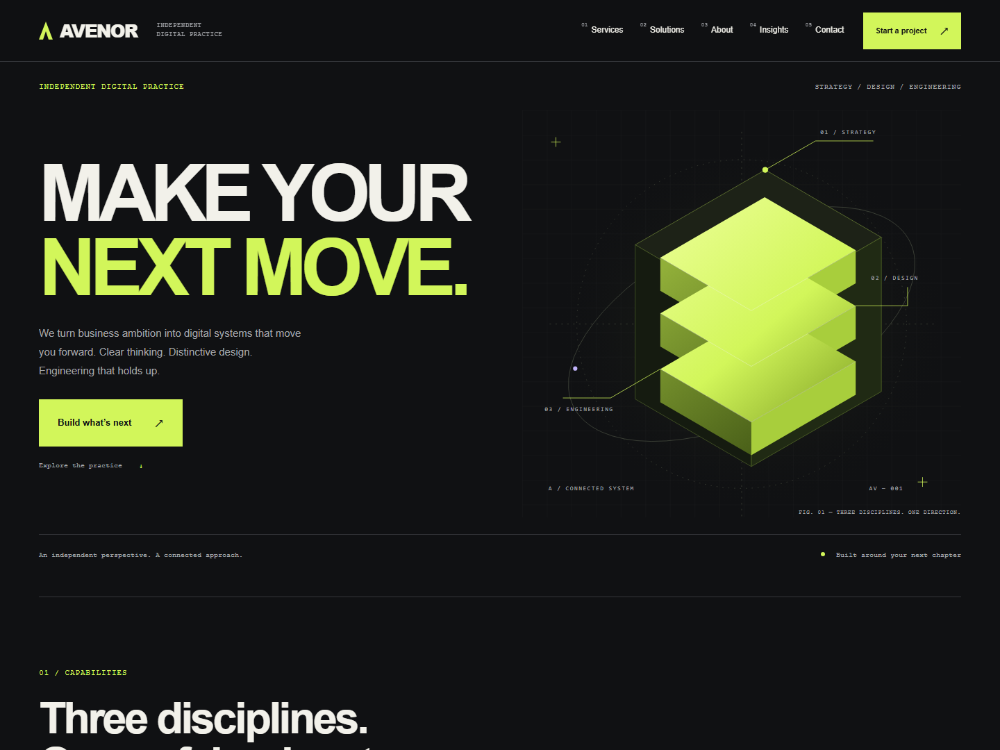
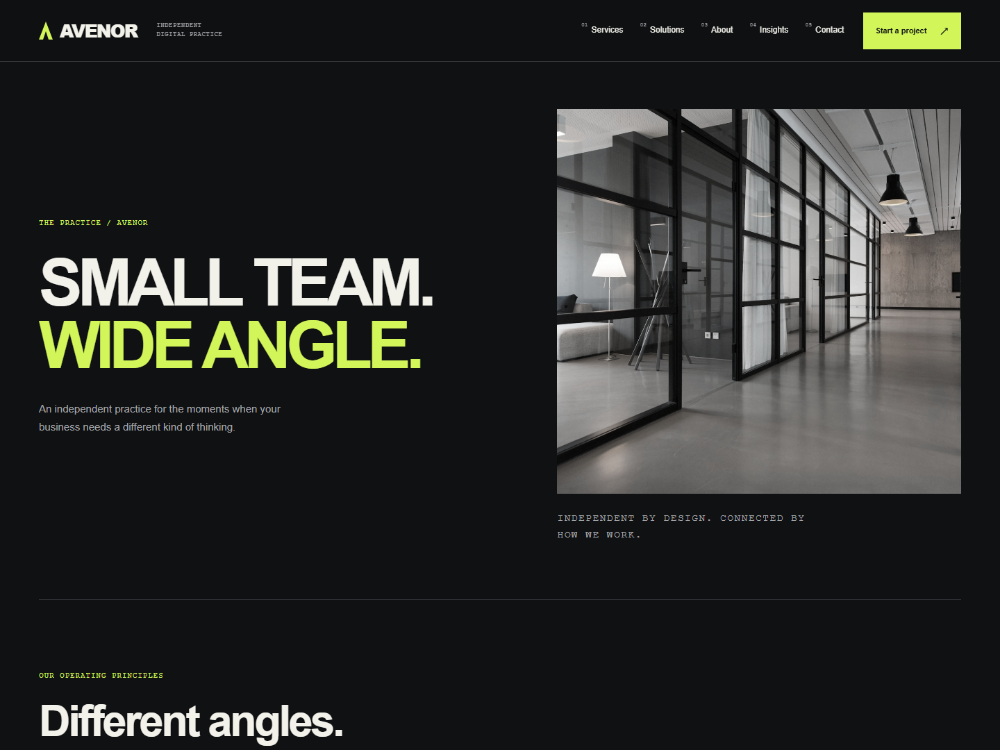
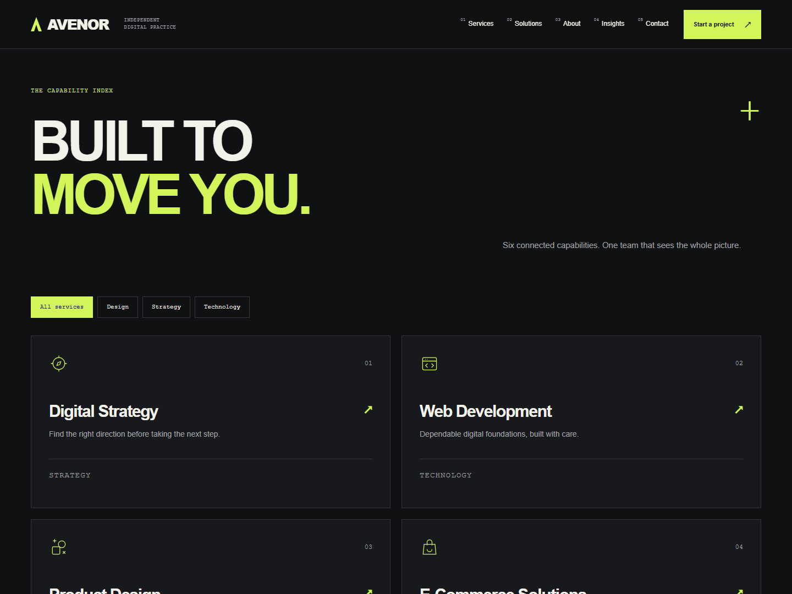
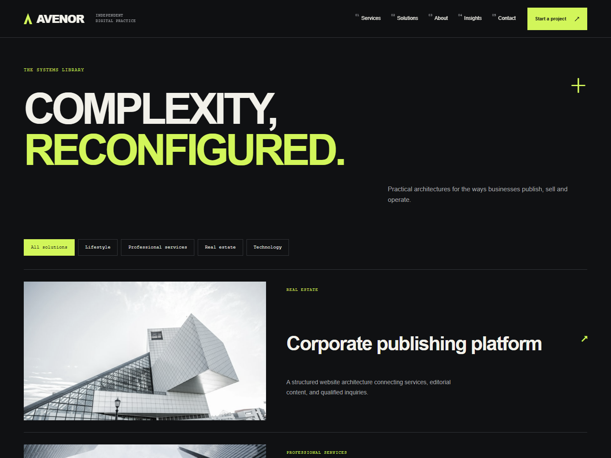
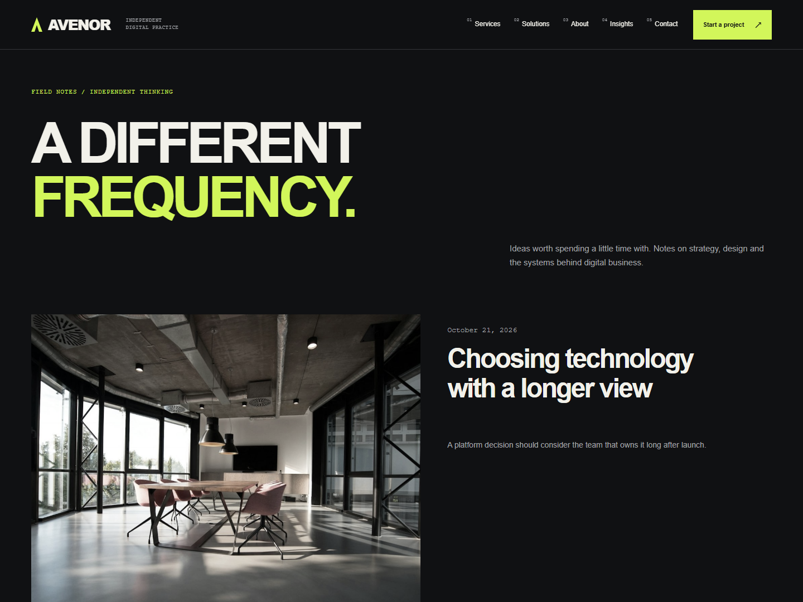
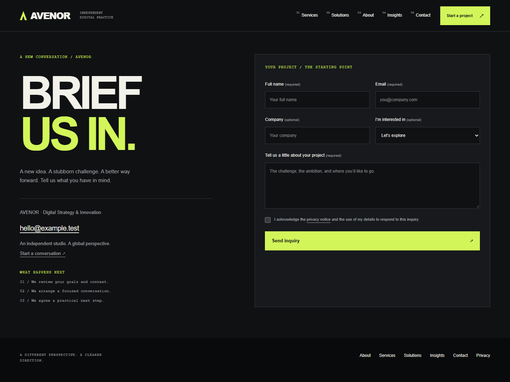

<div align="center">

# AVENOR

### Make your next move.

A premium corporate website and custom WordPress CMS for a digital consulting practice.

**Strategy · Design · Engineering**


[Screenshots](#desktop-showcase) · [Quick start](#quick-start) · [Features](#experience-and-capabilities) · [Architecture](#architecture) · [Content management](#content-management) · [Quality](#quality-and-verification) · [Documentation](#documentation)

</div>

## Overview

AVENOR brings an editorial visual identity, business publishing tools and a complete inquiry workflow into one WordPress project. A compact homepage introduces the practice; dedicated service, solution and article pages provide room for deeper content.

A custom block theme handles presentation, while the **AVENOR Core** companion plugin manages business content and inquiries. Editors work in the native WordPress interface. Shared PHP renderers, focused CSS components and native JavaScript modules keep the codebase maintainable.

| Area | Approach |
| --- | --- |
| Public experience | Responsive layouts, ink-black surfaces, electric chartreuse and bold grotesk typography |
| Content editing | Gutenberg, reusable patterns, template parts and full-site editing |
| Business functionality | Services, architecture guides, projects, inquiries and business settings |
| Interaction | Page entrances, scroll reveals, pointer feedback and animated mobile navigation |
| Delivery | Local Playground preview, Docker configuration and a supplied CI workflow |

## Desktop showcase

Six views of the AVENOR interface, captured at **1440 × 1080**. Select any image to open the full-resolution screenshot.

| Home · First impressions | About · The practice |
| :--- | :--- |
| [](docs/screenshots/01-home.png) | [](docs/screenshots/02-about.png) |
| Oversized grotesk typography, a custom geometric signal and a clear next step. | A new studio composition, operating principles and a connected delivery process. |

| Services · Connected expertise | Solutions · Architecture library |
| :--- | :--- |
| [](docs/screenshots/03-services.png) | [](docs/screenshots/04-solutions.png) |
| Category filters and structured cards make the available capabilities easy to explore. | A horizontal architecture catalog connects industry filters, scope and acceptance criteria. |

| Insights · Latest thinking | Contact · Start a conversation |
| :--- | :--- |
| [](docs/screenshots/05-insights.png) | [](docs/screenshots/06-contact.png) |
| A featured editorial story leads into a two-column collection of field notes. | A bold project-brief introduction, visible next steps and a structured inquiry panel. |

## Quick start

### Requirements

- **Node.js 24.18+** and npm for asset builds and the local preview.
- **PHP 8.3+** and Composer for PHP linting and integration tests.
- PHP extensions `mbstring`, `dom`, `xml`, `zip` and `pdo_sqlite` for the local test workflow.
- Docker Desktop or Docker Engine with Compose for the optional MySQL environment.

The project also pins a Node runtime as a development dependency. npm scripts use that runtime after installation.

### Run locally

```sh
npm ci
npm run build
npm run dev
```

| Destination | Address |
| --- | --- |
| Website | http://127.0.0.1:9400/ |
| Administration | http://127.0.0.1:9400/wp-admin/ |
| Local preview login | `admin` / `password` |

These credentials belong only to the local Playground environment. The preview runs actual WordPress with PHP 8.3 and SQLite. WordPress core and the database persist under the ignored `.runtime/site/` directory; custom source is mounted from `web/wp-content/`.

The first run downloads WordPress and prepares responsive images, so startup may take several minutes. Later runs reuse the installation. Initialization creates missing records and applies versioned migrations while preserving existing editorial changes. Restart the preview after adding template or pattern files so WordPress refreshes discovery caches.

## Experience and capabilities

### Public website

| Page | Purpose |
| --- | --- |
| **Home** · `/` | Editorial hero, expertise, selected services, in-house project, articles, FAQs and contact invitation |
| **About** · `/about/` | Practice perspective, disciplines, process and partnership commitments |
| **Services** · `/services/` | Filterable service archive and individual capability pages |
| **Solutions** · `/work/` | Architecture guides with scope, operational considerations and acceptance criteria |
| **Insights** · `/insights/` | Native WordPress articles and editorial detail pages |
| **Contact** · `/contact/` | Structured inquiry form, business details and next steps |
| **Privacy** · `/privacy/` | Inquiry processing and retention information |

Search, taxonomy archives, pagination, related content and a custom 404 complete the public experience. Solutions distinguish architecture guides from delivered projects; AVENOR's implemented platform has a separate in-house case study.

### Visual identity and motion

The public site and editor canvas share ink-black surfaces, electric chartreuse actions, lavender details and bold sans-serif typography. A custom vector signal introduces the three connected disciplines. Local photography, responsive images and system fonts support consistent rendering without a remote font dependency.

- Numbered desktop navigation with clear hover, focus and active states.
- A numbered mobile navigation sheet with a hamburger-to-cross transition.
- Staggered headline entrances, scroll reveals and bounded hero-image parallax.
- Fine-pointer card spotlights, button feedback and a decorative reading-progress indicator.
- Reduced-motion support, keyboard navigation, focus management and usable content without JavaScript.

Motion uses native browser APIs without an animation framework. Shared modules manage animation ownership and media preferences; interactive hit areas stay stationary during reveals.

### Business publishing

- Six initial services, six architecture guides and six editorial articles.
- Native content types for services, case studies, people and testimonials.
- Collection blocks with taxonomy, featured, related, count and column controls.
- Business settings for contact information, social links, calls to action and retention.
- Native revisions, featured images, excerpts and scheduled article publication.

Initialization does not publish invented staff or client endorsements. Team and testimonial blocks are available for approved records. Default contact details remain configured at the owner's request.

## Content management

| Task | WordPress location |
| --- | --- |
| Edit homepage text, images and section order | **Pages → Home**; use List View to move blocks |
| Change navigation, header, footer or archive introductions | **Appearance → Editor** |
| Manage capabilities and categories | **Services** |
| Publish architecture guides or delivered projects | **Case studies**; choose Entry type in AVENOR details |
| Publish articles | **Posts** |
| Manage approved profiles and endorsements | **Team / Testimonials** |
| Change email, business profile, social links and retention | **Settings → AVENOR business** |
| Review submissions and update workflow status | **Inquiries** |
| Export or erase associated personal data | **Tools → Export/Erase Personal Data** |

The theme includes **16 reusable patterns** and six custom blocks: Services Grid, Case Studies Grid, Contact Form, Team Grid, Testimonials and Business Profile. Patterns remain ordinary editable blocks after insertion.

Services and Solutions use native archives. Edit their introductions in the Site Editor rather than creating competing Pages at the same URLs. Archive batch sizes follow WordPress's main query; embedded collection counts are configured in the block sidebar and limited to 12.

See the [content guide](docs/content-guide.md) for publishing rules, collection settings and initialization behavior.

## Inquiry workflow

The contact form supports enhanced submission through **`POST /wp-json/avenor/v1/contact`** and native HTML submission when JavaScript is unavailable. Both transports share server-side validation and persistence rules.

1. Validate field types, Unicode character limits, email, service selection and privacy acknowledgment.
2. Apply payload limits, a honeypot, network rate limits and duplicate/concurrent-write protection.
3. Save a private inquiry before attempting email notification.
4. Track notification delivery state and expose the record to authorized administrators.
5. Manage workflow status, privacy requests and scheduled retention cleanup.

| Concern | Implementation |
| --- | --- |
| Required input | Name, valid email, message of at least 20 characters and privacy acknowledgment |
| Optional input | Company and a published service selection |
| Record visibility | Private `avenor_inquiry` records; administrator capabilities by default |
| Workflow | New, In progress, Resolved or Spam |
| Notification failure | The saved inquiry remains available with its delivery state |
| Retention | 365 days by default; configurable, with daily batches of up to 100 expired records |
| Privacy | WordPress personal-data export and erasure integration |

Inquiries and business settings are preserved on plugin uninstall. External mailbox delivery requires a configured mail transport and separate verification.

## Architecture

The theme owns presentation. The plugin owns business records, validation, settings and inquiry processing. WordPress provides the editor, routing, authentication and persistence APIs.

```text
web/wp-content/
├── themes/avenor/
│   ├── theme.json           Design tokens and editor configuration
│   ├── templates/           Native block template hierarchy
│   ├── parts/               Shared header and footer
│   ├── patterns/            Reusable editable compositions
│   ├── inc/                 Setup, assets and SEO hooks
│   └── assets/
│       ├── css/             Focused CSS sources and ordered manifest
│       ├── js/              Motion, navigation and shared modules
│       ├── modules.json     Native module dependency graph
│       ├── build/           Generated frontend and editor CSS
│       └── images/          Local photography and interface capture
└── plugins/avenor-core/
    ├── avenor-core.php      Bootstrap and namespace autoloader
    ├── src/
    │   ├── Content/         Types, taxonomies and REST metadata
    │   ├── Blocks/          Queries, cards, contact views and renderers
    │   ├── Contact/         Validation, persistence, admin and privacy
    │   └── Settings/        Business Settings API
    ├── blocks/              Block metadata and editor components
    ├── build/               Generated editor bundle
    ├── assets/js/           Progressive contact enhancement
    └── tests/               PHP integration coverage

tools/                      Preview, builds, initialization and checks
tools/seed/                 Ordered content steps and shared helpers
tests/                      Browser suite and PHP test bootstrap
docs/                       Design, architecture, editing and verification
.github/workflows/ci.yml     Supplied PHP, MySQL and browser workflow
```

### Reuse and source boundaries

Collection queries and card renderers are shared across homepage sections, archives, taxonomy filters and related content. Contact rendering and validation have focused components. Editor controls reuse shared fields and options; initialization is divided into ordered content steps.

CSS uses **9 ordered source components** compiled into one frontend stylesheet and one editor stylesheet. Native frontend modules resolve through WordPress's import map, with individual file versions for cache invalidation.

`npm run check:architecture` checks module dependencies, cycles, missing or unused registrations, the CSS manifest, and source components exceeding **10 KB or 240 lines**. Generated assets, dependencies and tests are excluded from the size rule.

## Development commands

| Command | Purpose |
| --- | --- |
| `npm run dev` | Start the persistent WordPress Playground preview |
| `npm run build` | Build the Gutenberg editor bundle and both CSS bundles |
| `npm run build:styles` | Compile CSS from the ordered source manifest |
| `npm run lint:js` | Lint editor and frontend JavaScript |
| `npm run check:architecture` | Validate source boundaries, manifests and dependency graphs |
| `npm run test:php` | Check PHP syntax; accepts an optional `PHP_BINARY` environment variable |
| `npm run prepare:php-tests` | Prepare the isolated PHP test environment after the first preview run |
| `composer lint` | Check PHP against configured WordPress coding standards |
| `composer test` | Run PHP integration tests against WordPress |
| `npm test` | Clean local browser fixtures and run Playwright |

Commit generated theme CSS and the plugin editor bundle alongside source changes. WordPress core, dependencies, uploads, local databases and browser artifacts are excluded from source control.

### Run the quality checks

```sh
composer install
npm run build
npm run lint:js
npm run check:architecture
npm run test:php
composer lint

# After starting the local preview at least once:
npm run prepare:php-tests
composer test

# Keep the preview running in another terminal:
npx playwright install chromium
npm test
```

PHP integration tests use an isolated disposable SQLite database. To use a disposable MySQL WordPress installation, set `AVENOR_TEST_WP_ROOT` to its root before running `composer test`.

Browser tests accept `BASE_URL`, `WP_ADMIN_USER` and `WP_ADMIN_PASSWORD`. They exercise publishing, editing and inquiries, restore homepage content, and delete temporary records. Before local runs, setup clears only loopback rate-limit allowances in this project's Playground database. Use a dedicated test installation because the suite creates and deletes content.

## Quality and verification

The prior recorded local audit was completed on **22 October 2026**. The Signal redesign on **29 October 2026** replaces the presentation system; its validation is documented in the verification report. These are executed local results; the supplied GitHub Actions workflow has not been run from this environment.

| Check | Recorded result |
| --- | --- |
| Browser integration | **24 Playwright tests passed**, with no skipped or flaky tests |
| PHP integration | **14 tests · 80 assertions passed** |
| PHP syntax | **67 files passed** after retiring obsolete presentation sources |
| JavaScript / PHP standards | Lint and WordPress coding checks passed |
| Asset builds and architecture | Editor bundle, compiled styles and source checks passed |
| Gutenberg validation | All **16 patterns** parsed as valid blocks |
| Prior visual regression review | The earlier audit recorded 16 comparisons; Signal intentionally replaces that appearance |
| Automated accessibility | No violations for configured axe tags on eight public pages and the mobile drawer |
| Production npm audit / Composer audit | No known advisories reported in the recorded runs |

Coverage includes public routes, filters, search, pagination, contact validation, both submission transports, inquiry privacy, publishing, navigation, reduced motion, images and responsive overflow. PHP tests cover capabilities, persistence, rate limits, duplicates, notification failure, settings and privacy behavior.

The audit recorded **60 remaining development-tool npm advisories**. Local validation used SQLite; Docker/MySQL execution, remote CI, external email delivery and deployed performance remain unverified. Automated accessibility checks do not establish full WCAG conformance. See the [verification history](docs/verification.md) and [technical audit](docs/code-quality-audit.md) for evidence and scope.

## Docker and MySQL

The optional Compose environment uses **MySQL 8.4**, **WordPress with PHP 8.3 and Apache**, and **WP-CLI**. Start Docker, copy the environment file and choose local database and administrator credentials.

```powershell
# Windows PowerShell
Copy-Item .env.example .env
```

```sh
# Linux / macOS
cp .env.example .env
```

Then initialize the environment:

```sh
npm ci
npm run build
docker compose up -d db wordpress
docker compose run --rm --entrypoint sh cli avenor-tools/init.sh
```

Open **http://localhost:8080/** and **http://localhost:8080/wp-admin/**. Initialization reads administrator credentials from `.env`; run it once for a new database.

| Variable | Purpose |
| --- | --- |
| `WORDPRESS_PORT` | Host port; defaults to `8080` |
| `MYSQL_DATABASE` / `MYSQL_USER` | Application database and account |
| `MYSQL_PASSWORD` / `MYSQL_ROOT_PASSWORD` | Database credentials |
| `WP_ADMIN_USER` / `WP_ADMIN_PASSWORD` | Initial WordPress administrator |
| `WP_ADMIN_EMAIL` | Administrator email |

To create missing editorial records again without resetting existing edits:

```sh
docker compose run --rm cli eval-file avenor-tools/seed.php
```

`docker compose down` preserves the named database and WordPress volumes. Compose binds the website to loopback for local use. Keep `.env` private; it is ignored by source control.

## Deployment and operations

Build assets before deploying the `avenor` theme and `avenor-core` plugin to WordPress. Activate both, configure permalinks, and initialize content once if the destination is a new installation. Migrating an existing site also requires its database and media uploads; copying source alone does not transfer editorial content.

Configure HTTPS, mail delivery, database credentials, backups and a reliable WP-Cron scheduler for the hosting environment. Confirm the destination URL and business settings, then verify a submission through storage, administration and external notification. Default contact details remain in place until changed in business settings.

Keep WordPress, plugins and build dependencies maintained. Measure deployed performance with representative hosting, images and content; the repository does not claim a Lighthouse or Core Web Vitals score.

## Troubleshooting

| Symptom | Check |
| --- | --- |
| First preview boot takes longer | Initial WordPress download and image generation; wait for the application-ready message |
| New template or pattern is missing | Restart the preview to refresh WordPress discovery |
| Source CSS changes do not appear | Run `npm run build:styles`; pages load the generated bundle |
| Editor control changes do not appear | Run `npm run build` and reload the editor |
| PHP checks cannot find an executable | Install PHP 8.3+ or set `PHP_BINARY` |
| Contact is saved but notification fails | Inspect inquiry delivery state and the configured mail transport |
| Docker site is unavailable | Start Docker; inspect `docker compose ps` and `docker compose logs wordpress` |
| Service or solution archive conflicts with a Page | Use the native archive route and edit its template in the Site Editor |

## Documentation

| Guide | Contents |
| --- | --- |
| [Architecture](docs/architecture.md) | Theme/plugin responsibilities, data model and request flow |
| [Content guide](docs/content-guide.md) | Editing, publishing, collections and business settings |
| [Design specification](docs/design-specification.md) | Visual direction, layouts and interface conventions |
| [Technical audit](docs/code-quality-audit.md) | Component boundaries, checks and remaining findings |
| [Verification](docs/verification.md) | Executed results, release history and validation limits |
| [Media credits](docs/media-credits.md) | Photography sources and attribution |

Implementation references: [WordPress hosting requirements](https://wordpress.org/about/requirements/), [block metadata](https://developer.wordpress.org/block-editor/reference-guides/block-api/block-metadata/) and [WordPress Playground](https://developer.wordpress.org/playground/).
