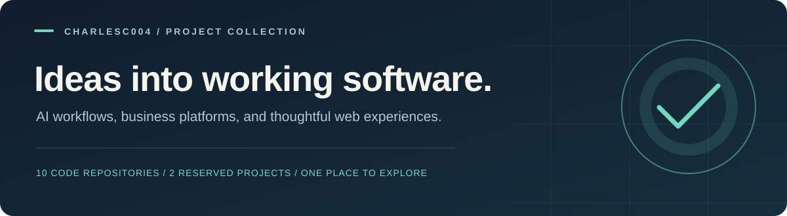

**Independent projects. Practical problems. Connected experiences.**

A curated collection of my public software projects, with a focus on full-stack applications, backend systems, and applied AI.

[Featured projects](#featured-projects) · [More to explore](#more-to-explore) · [Technical focus](#technical-focus) · [My profile](https://github.com/charlesc004)

## Featured projects

Click a project title or preview to open its independent repository.

<table>
<tr>
<td width="50%" valign="top">

<h3><a href="https://github.com/charlesc004/agentcore-ai">AgentCore AI</a></h3>

Visual AI workflows with specialized agents, human approvals, and execution monitoring.

<strong>Built with</strong> Next.js · React · TypeScript · React Flow · FastAPI · SQLAlchemy

<a href="https://github.com/charlesc004/agentcore-ai">Explore source &amp; documentation →</a>
</td>
<td width="50%" valign="top">

<h3><a href="https://github.com/charlesc004/synqra-ai">SYNQRA AI</a></h3>

Search documents, ask questions with cited answers, and run human-approved knowledge workflows.

<strong>Built with</strong> Next.js · TypeScript · FastAPI · PostgreSQL / pgvector · LangGraph

<a href="https://github.com/charlesc004/synqra-ai">Explore source &amp; documentation →</a>
</td>
</tr>
<tr>
<td width="50%" valign="top">

<h3><a href="https://github.com/charlesc004/SentinelML">SentinelML</a></h3>

Event-driven fraud detection with model inference, risk policies, and analyst investigations.

<strong>Built with</strong> Go · Rust / ONNX · Rails · Next.js · Python · Redpanda

<a href="https://github.com/charlesc004/SentinelML">Explore source &amp; documentation →</a>
</td>
<td width="50%" valign="top">

<h3><a href="https://github.com/charlesc004/Tickora-helpdesk">TICKORA</a></h3>

A support workspace for tickets, team conversations, SLA tracking, and operational reporting.

<strong>Built with</strong> C# · ASP.NET Core · Blazor · EF Core · SQL Server · SignalR

<a href="https://github.com/charlesc004/Tickora-helpdesk">Explore source &amp; documentation →</a>
</td>
</tr>
</table>

## More to explore

| Project | What it does | Technologies |
| :--- | :--- | :--- |
| [**Nexus CRM**](https://github.com/charlesc004/Nexus-Crm-SaaS) | Organization-scoped customer relationship management with leads, deals, tasks, and reporting. | Next.js · TypeScript · NestJS · Prisma · PostgreSQL |
| [**PRISM**](https://github.com/charlesc004/Prism-BI-platform) | Business intelligence for connected commerce data, background synchronization, and interactive reporting. | Angular · TypeScript · Node.js · PostgreSQL · Prisma · Redis · BullMQ |
| [**SERENO Studio**](https://github.com/charlesc004/sereno-booking-platform) | Appointment booking and studio operations with availability rules, team schedules, and customer records. | Vue · TypeScript · Vite · FastAPI · SQLAlchemy · PostgreSQL |
| [**VELORA**](https://github.com/charlesc004/Velora-e-commerce-platform) | Fashion storefront and administration workspace with catalog, inventory, and test checkout flows. | React · TypeScript · Vite · Express · MongoDB |
| [**AVENOR**](https://github.com/charlesc004/Avenor-worpress-website) | Corporate publishing website with a custom block theme, reusable content, and inquiry management. | WordPress · PHP · Gutenberg · JavaScript · CSS |
| [**f-society**](https://github.com/charlesc004/f-society) | Nuxt and Vue application with sign-in screens, authentication routing, and a dashboard. | Nuxt · Vue · TypeScript · Tailwind CSS · VueUse Motion |

## Technical focus

| Area | Work represented in these projects |
| :--- | :--- |
| Backend & APIs | ASP.NET Core, FastAPI, NestJS, Express, authentication, authorization, and business workflows |
| Frontend | React / Next.js, Vue / Nuxt, Angular, TypeScript, and responsive application interfaces |
| Data & processing | PostgreSQL, SQL Server, MongoDB, Redis, background jobs, and event-driven processing |
| Applied AI | Document retrieval, vector search, agent orchestration, human approval, and model inference |
| Delivery & quality | Docker, GitHub Actions, automated tests, and project documentation |

## Reserved repositories

These repositories do not currently contain application code; their technology stacks are not yet defined.

- [Delusion](https://github.com/charlesc004/Delusion) — empty repository.
- [Tickora-helpdesk-platform](https://github.com/charlesc004/Tickora-helpdesk-platform) — empty repository.

---

Every project has its own code, setup guide, and development history.

[**Explore my GitHub profile →**](https://github.com/charlesc004)

