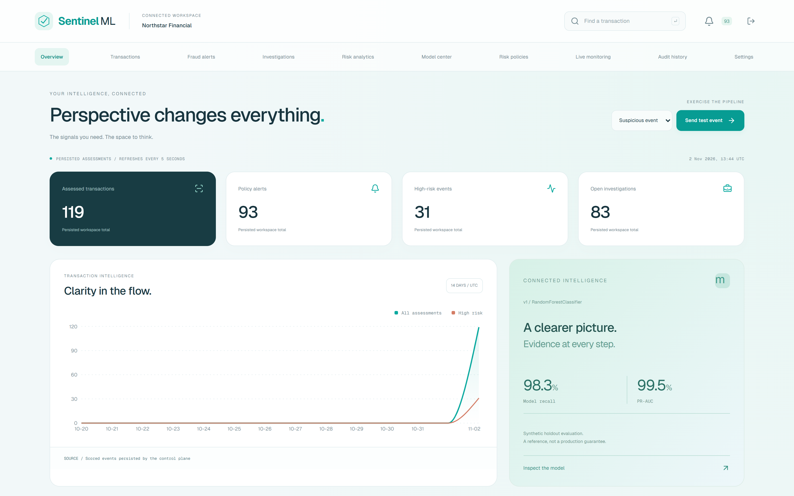
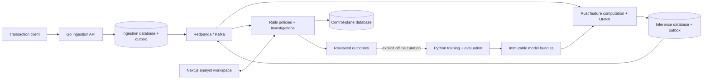
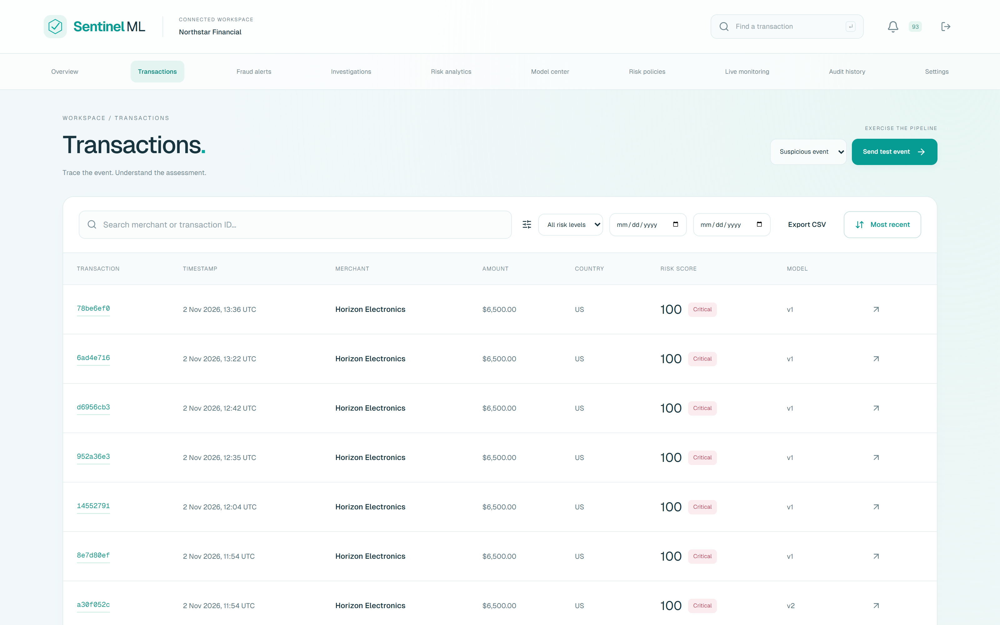
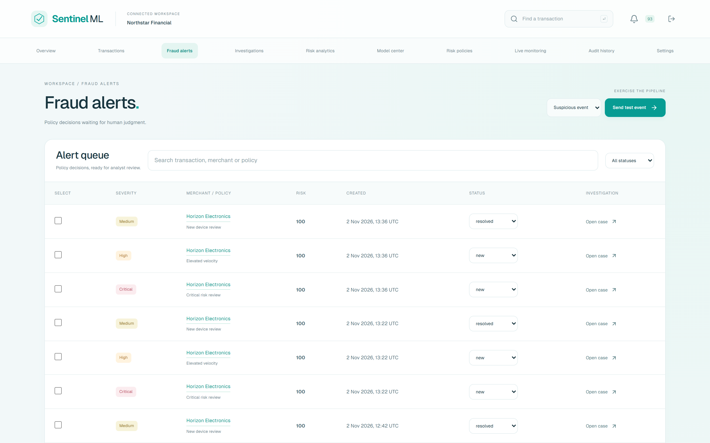
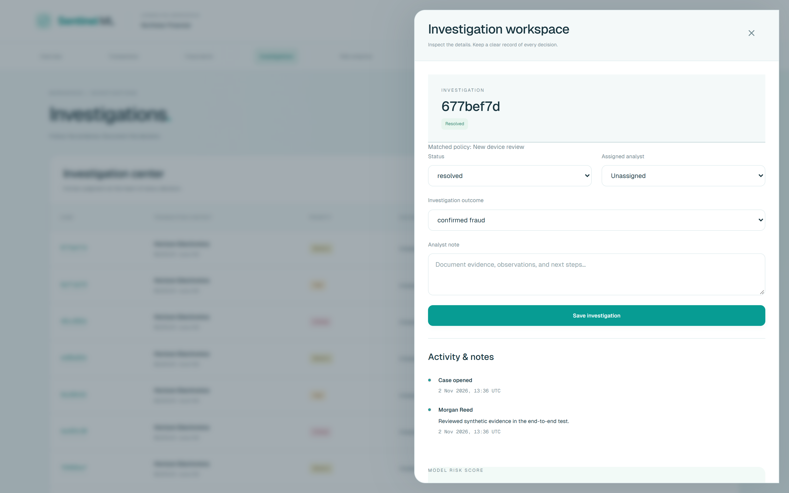
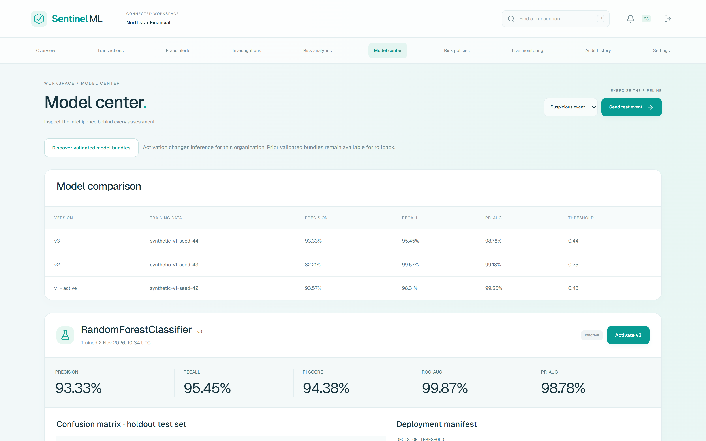
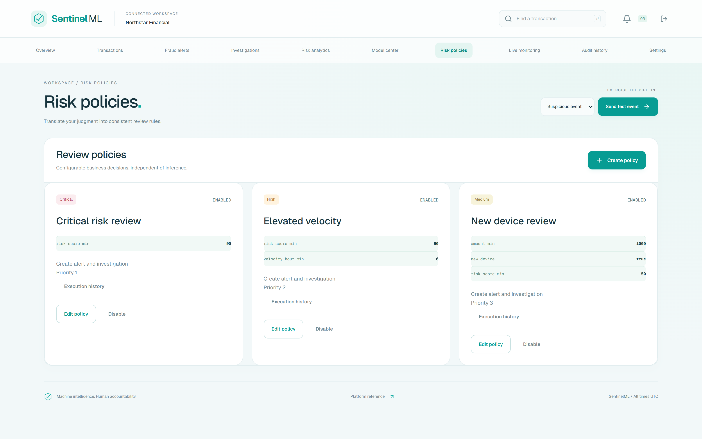

# SentinelML

### Real-time fraud intelligence, from transaction to investigation.

[](https://github.com/charlesc004/SentinelML/actions/workflows/ci.yml)


SentinelML is an event-driven fraud detection and analyst investigation platform. **Go** durably accepts transactions, **Redpanda** transports events, **Rust** runs an actual ONNX classifier, and **Rails** evaluates risk policies and manages investigations. A **Next.js** workspace connects model evidence, review decisions and operational context; **Python** provides reproducible training and evaluation.

This repository contains the complete application, versioned model bundles, database migrations, event contracts, automated tests and deployment configuration. The demonstration uses synthetic or tokenized records and does not execute payments.



[Quick start](#quick-start) · [Architecture](#architecture) · [Screenshots](#product-tour) · [Model pipeline](#machine-learning-pipeline) · [Verification](#verification) · [Documentation](#documentation)

## What the platform does

- **Durable transaction ingestion:** authenticated API keys, strict payload validation, organization-scoped idempotency, Redis rate limiting and a transactional outbox.
- **Real model execution:** ordered behavioral features, ONNX Runtime inference in Rust, persisted assessments and versioned model selection.
- **Configurable risk policies:** thresholds and feature conditions, priorities, execution history, alerts and automatic investigation creation.
- **Analyst investigations:** assignment, evidence inspection, notes, review outcomes, optimistic concurrency and a traceable activity history.
- **Model governance:** immutable bundles, measured evaluation reports, version comparison, activation, rollback, feature importance and drift analysis.
- **Tenant-aware administration:** revocable sessions, server-side roles, member management, ingestion credential rotation, retention controls and audit records.
- **Operational visibility:** structured logs, metrics, Prometheus rules, Grafana provisioning, bounded retries and durable dead-letter queues.
- **A cohesive analyst interface:** the light VECTOR visual system, horizontal navigation, responsive layouts, accessible forms, notifications and CSV exports.

## Architecture



| Layer | Stack | Responsibility |
| --- | --- | --- |
| Ingestion | Go, Chi, GORM, franz-go | Validation, key authentication, idempotency, durable acceptance and event publication |
| Inference | Rust, Axum, Tokio, SeaORM, ONNX Runtime | Feature computation, model execution, version selection and durable scoring |
| Control plane | Ruby, Rails, ActiveRecord, Karafka, Sidekiq, Pundit | Policies, alerts, investigations, feedback, users, audits and administration |
| Analyst application | Next.js, React, TypeScript, TanStack Query, Recharts | Service-backed operational and investigation workflows |
| Machine learning | Python, scikit-learn, Pandas, NumPy, ONNX | Chronological training, cost-sensitive threshold selection, evaluation and export |
| Infrastructure | PostgreSQL, Redis, Redpanda, Caddy, Prometheus, Grafana | Service-owned storage, event transport, gateway and observability |

Each application service owns its database and login role. Services exchange HTTP requests and versioned events rather than joining another service's tables. Delivery is **at least once**, with idempotent consumers and durable outboxes.

See [architecture](docs/architecture.md), [database ownership](docs/data-model.md) and [event contracts](docs/event-contracts.md).

## Quick start

### Requirements

- Docker Engine or Docker Desktop with Compose v2.
- Registry access for the initial image build and approximately 8 GiB of available RAM.
- Python 3.12+ for the optional traffic generator and HTTP verification scripts.

### 1. Configure the local environment

```sh
cp .env.example .env
```

In PowerShell, use `Copy-Item .env.example .env`. Preserve an existing configured `.env`.

Replace `SECRET_KEY_BASE` and `INTERNAL_SERVICE_TOKEN` with independent random values. For example, run `openssl rand -hex 64` separately for each value. `.env` is excluded from Git.

The default gateway port is `8080`. Set `APP_PORT=8180`, or another available port, if necessary. Demo mode is enabled by the example configuration.

### 2. Start the services and seed the demo workspace

```sh
docker compose up -d --build
docker compose exec -T control bundle exec rails db:seed
```

Compose runs database migrations before starting the corresponding application services. The included model bundles make initial training optional. Seeding creates demo users, risk policies and registry metadata; transaction records and assessments are generated through the real pipeline.

### 3. Open the application

Visit **[http://localhost:8080](http://localhost:8080)** and select **Try the live demo**. The login page also shows the default demo credentials:

```text
Email:     admin@sentinelml.example
Password:  LocalDemo!2026
```

One-click access is available only when `DEMO_ENABLED=true`. The server verifies the configured demo account and password, applies the normal rate limit, checks account status, rotates the session and requires CSRF protection. Set `DEMO_ENABLED=false` to disable the demo endpoint and hide the demo controls. The displayed hint uses the default credentials; manual login must use your configured `DEMO_PASSWORD` if it differs.

Additional seeded roles include `alex.carter@sentinelml.example` (analyst), `taylor.brooks@sentinelml.example` (risk manager) and `casey.blake@sentinelml.example` (viewer). They initially use the configured demo password.

### 4. Send transactions through the pipeline

Use **Send test event** in the application, or run:

```sh
python scripts/demo_traffic.py --count 100
python scripts/verify_pipeline.py
```

For a nondefault gateway port:

```sh
python scripts/demo_traffic.py --url http://localhost:8180/ingest --count 100
SENTINEL_BASE_URL=http://localhost:8180 python scripts/verify_pipeline.py
```

PowerShell: set `$env:SENTINEL_BASE_URL='http://localhost:8180'` before running the verifier. Set `E2E_BASE_URL` similarly for browser tests.

### Local endpoints

| Resource | Default address |
| --- | --- |
| Analyst workspace | http://localhost:8080 |
| Interactive API reference | http://localhost:8080/api-reference |
| OpenAPI specification | [docs/openapi.yaml](docs/openapi.yaml) |
| Transaction ingestion | `POST http://localhost:8080/ingest/v1/transactions` |
| Prometheus | http://localhost:9090 |
| Grafana | http://localhost:3002 |

Grafana's local default is `admin` / `local-grafana-change-me`; configure `GRAFANA_PASSWORD` to change it. Application and monitoring ports bind to loopback in Compose.

## Product tour

All images below are captured from the running application using the synthetic demo workspace. Each image is a fixed landscape viewport rather than a long scrolling capture.

| Transactions | Fraud alerts |
| --- | --- |
|  |  |

| Investigations | Model center |
| --- | --- |
|  |  |

<details>
<summary>Risk policy management</summary>



</details>

## Transaction-to-investigation workflow

1. A client sends a tokenized transaction with an ingestion Bearer key and an `Idempotency-Key`.
2. Go validates the request and atomically commits the accepted transaction and its outbox record. A `202` response means durable acceptance; scoring is asynchronous.
3. The event reaches Rust through Redpanda. Rust validates the contract, computes the ordered features and executes the selected ONNX model.
4. Rust persists the assessment and scoring event. Rails consumes that event idempotently and evaluates the organization's enabled policies.
5. Matching policies create alerts and, when configured, investigation cases. Analysts inspect evidence, assign ownership, add notes and record an outcome.
6. Reviewed outcomes become traceable feedback for explicitly curated offline training. They do not silently retrain or replace the live model.

The verifier covers replay, conflicting idempotency keys, model execution, policy matches, optimistic concurrency, feedback, CSV reporting, model activation and rollback, credential lifecycle and role enforcement.

## Machine learning pipeline

The committed bundles contain an actual class-weighted random forest exported to ONNX, with model metadata, ordered feature contracts, checksums, threshold comparisons and holdout reports.

The v1 training run uses 18,000 synthetic records, split chronologically into 60% training, 20% validation and 20% holdout. A 100-tree forest uses maximum depth 10. Threshold selection uses validation data with false-negative cost 20 and false-positive cost 1. Exported ONNX probabilities are checked against scikit-learn at absolute tolerance `1e-5`.

| v1 synthetic holdout metric | Measured value |
| --- | ---: |
| Precision | 0.935743 |
| Recall | 0.983122 |
| F1 score | 0.958848 |
| ROC-AUC | 0.999640 |
| PR-AUC | 0.995494 |
| Confusion matrix `[[TN, FP], [FN, TP]]` | `[[3347, 16], [4, 233]]` |

These are **synthetic evaluation results**, not estimates of financial performance. Refer to the original [metadata](ml/artifacts/v1/metadata.json), [metrics](ml/artifacts/v1/metrics.json) and [threshold comparisons](ml/artifacts/v1/threshold_comparison.json). Bundles v2 and v3 provide additional measured versions; v3 includes forest feature importance.

### Train a new immutable bundle

```sh
python -m venv .venv
# Activate the environment for your shell.
python -m pip install -r ml/requirements.lock.txt
python -m ml.src.train --output ml/artifacts/v4 --size 18000 --seed 45 --false-negative-cost 20 --false-positive-cost 1
```

Training refuses to overwrite an existing bundle. Discover the new version in Model center and activate it for the organization. Selecting a previous bundle performs rollback without restarting inference. Existing records retain their execution version.

See [training, drift and feedback](docs/ml-pipeline.md).

## Verification

The latest local verification includes **29 Rails examples**, **7 browser tests** and **3 frontend unit tests**. Earlier distributed checks also exercised contract compatibility, Python training/export parity, real PostgreSQL/Redis integration, Rust ONNX execution, broker recovery, duplicate delivery and dead-letter handling. The dated [verification report](docs/verification.md) distinguishes individual runs and their scope.

### Frontend

```sh
cd frontend
npm ci
npm run lint
npm run typecheck
npm test
npm run build
npx playwright install chromium
E2E_BASE_URL=http://localhost:8080 npm run test:e2e -- --workers=1
```

The live stack must be running and seeded for the browser integration tests. Empty/error-state tests use test-only interception; the transaction and demo-login journeys use the actual backend.

### Python and contracts

```sh
python -m pip install -r ml/requirements.lock.txt
python -m pytest ml/tests contracts -q
```

### Isolated service integration tests

```sh
# Rails with dedicated PostgreSQL and Redis:
docker compose build control
docker compose -f infrastructure/docker/compose.test.yml up --abort-on-container-exit --exit-code-from rails

# Rust model tests and dedicated PostgreSQL integration:
docker build --target test -f services/inference/Dockerfile -t sentinelml-inference-test-runner .
docker compose -f infrastructure/docker/compose.rust-test.yml up --abort-on-container-exit --exit-code-from tests

# Go tests with dedicated PostgreSQL and Redis:
docker build --build-context contracts=./contracts --target integration-test -t sentinelml-ingestion-test-runner services/ingestion
docker compose -f infrastructure/docker/compose.go-test.yml up --abort-on-container-exit --exit-code-from tests
```

Native Go, Rust and Ruby commands, dependency checks, operational verification and test boundaries are documented in [verification](docs/verification.md). CI is defined in [.github/workflows/ci.yml](.github/workflows/ci.yml); a workflow definition is not itself evidence that a run passed.

## Security and operational boundaries

- Application data is scoped to an organization; authorization is enforced on the server.
- Sessions are revocable and protected by CSRF checks. Ingestion keys are hashed, shown once at creation and support rotation/revocation.
- Transaction contracts reject unsupported fields. Use synthetic or tokenized values; do not submit payment credentials.
- Outboxes, retries, idempotent consumers and dead-letter queues handle asynchronous delivery failures.
- Retention preserves open investigations and pending publication; backup and replay tools require deliberate operator actions.
- Committed example values are local demonstration defaults. Actual `.env` files, database dumps, backups, installation caches and temporary exports are excluded from Git.

Before remote deployment, disable demo access, replace local credentials, configure secure cookies and TLS, provision managed dependencies and validate model behavior against an approved dataset. Kubernetes manifests are included as deployment templates; a remote cluster, production capacity SLA and regulatory certification are not claimed. MFA/SSO, invitations, self-service recovery and external notification delivery are outside the current scope.

Read [SECURITY.md](SECURITY.md) and the detailed [security model](docs/security.md).

## Repository structure

```text
frontend/                 Next.js analyst workspace and browser tests
services/ingestion/       Go ingestion API, GORM repositories and migrations
services/inference/       Rust features, ONNX runtime, consumers and persistence
services/control-plane/   Rails domain, APIs, policies, consumers and jobs
ml/src/                   Training, evaluation, features, drift and feedback utilities
ml/artifacts/             Immutable v1, v2 and v3 model bundles and measured reports
contracts/                Versioned event schemas, fixtures and compatibility tests
infrastructure/           Compose tests, Kubernetes, gateway and observability
scripts/                  Traffic generation, verification, replay, backup and audits
docs/                     Architecture, operations, verification and product screenshots
```

## Documentation

| Guide | Contents |
| --- | --- |
| [Architecture](docs/architecture.md) | Service boundaries and end-to-end processing |
| [Data model](docs/data-model.md) | Database ownership and persisted entities |
| [Event contracts](docs/event-contracts.md) | Versioning, delivery and replay semantics |
| [ML pipeline](docs/ml-pipeline.md) | Training, exports, feature contracts and drift |
| [Deployment](docs/deployment.md) | Local setup, migrations, operations and Kubernetes |
| [Security](docs/security.md) | Authentication, tenancy and deployment assumptions |
| [Verification](docs/verification.md) | Executed checks, reproduction steps and limits |
| [Delivery report](docs/delivery-report.md) | Implemented capabilities and practical scope |
| [OpenAPI](docs/openapi.yaml) | HTTP API reference |
| [Source inventory](docs/project-tree.txt) | Publishable source and model artifact inventory |

For development and review conventions, see [CONTRIBUTING.md](CONTRIBUTING.md).
