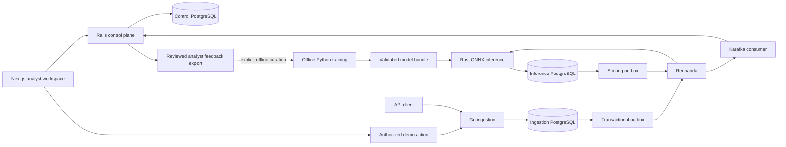

# Architecture

SentinelML separates transaction acceptance, probabilistic assessment, and human review.

Go accepts bounded, strictly decoded payloads. Tenant identity comes from the hashed ingestion key, never from the caller's JSON. It writes a transaction and outbox event in one database transaction. A conflicting reuse of an idempotency key returns 409.

Rust validates event schema and ownership before generating ordered float32 features. The actual ONNX random forest returns class probabilities. Rust rounds probability × 100 to obtain a presentation score. Risk levels are low 0–39, medium 40–69, high 70–89, and critical 90–100. These ranges do not determine an external payment action.

The Rails consumer locks the destination organization, deduplicates the transaction, evaluates a safe AND-based rule DSL, and persists alerts, optional cases, audit records, and outgoing events together. Rails owns business decisions. The browser never computes production risk assessments.

The UI reads authenticated control-plane DTOs. All metrics are counts of tenant-owned records or actual offline evaluation results. Synthetic demo generation invokes Go through the same path as an API client. A blank database produces empty states rather than fabricated charts.

Delivery is at least once. An event may be published again if a process crashes after broker acknowledgement and before marking its outbox row. Consumers use unique constraints and transactional processing to avoid duplicate domain records. Poison messages go to dead-letter topics after bounded processing attempts; failures publishing the dead-letter record prevent offset advancement. A database outage lasting longer than this retry window can route otherwise valid events to the DLQ; recovery requires operator replay.

Current implementation limits: see [verification.md](verification.md). It is a development baseline, not an independently certified or production-qualified financial platform.
